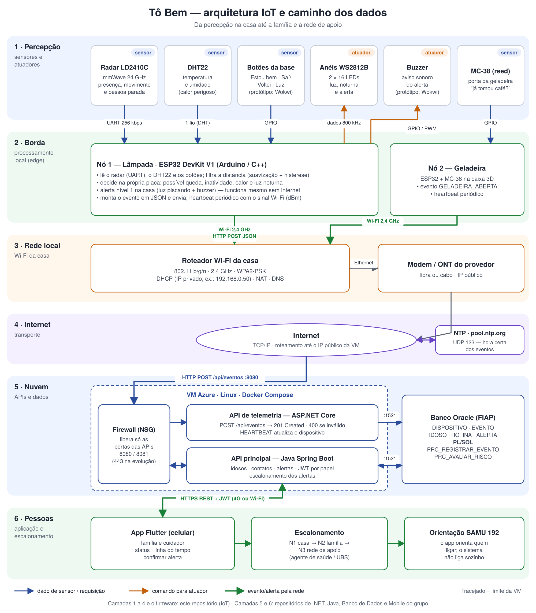
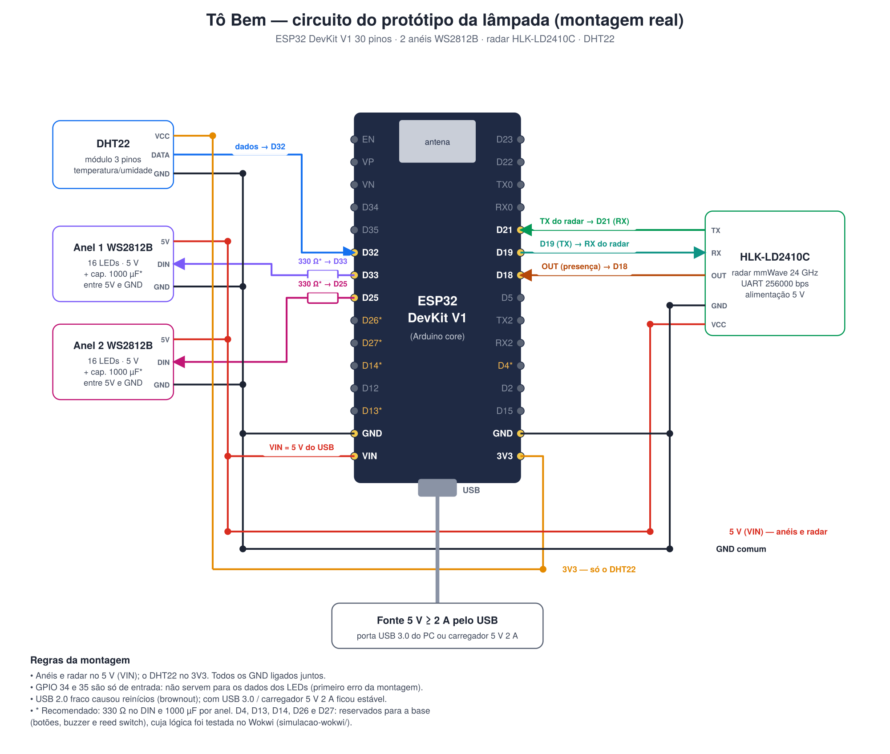
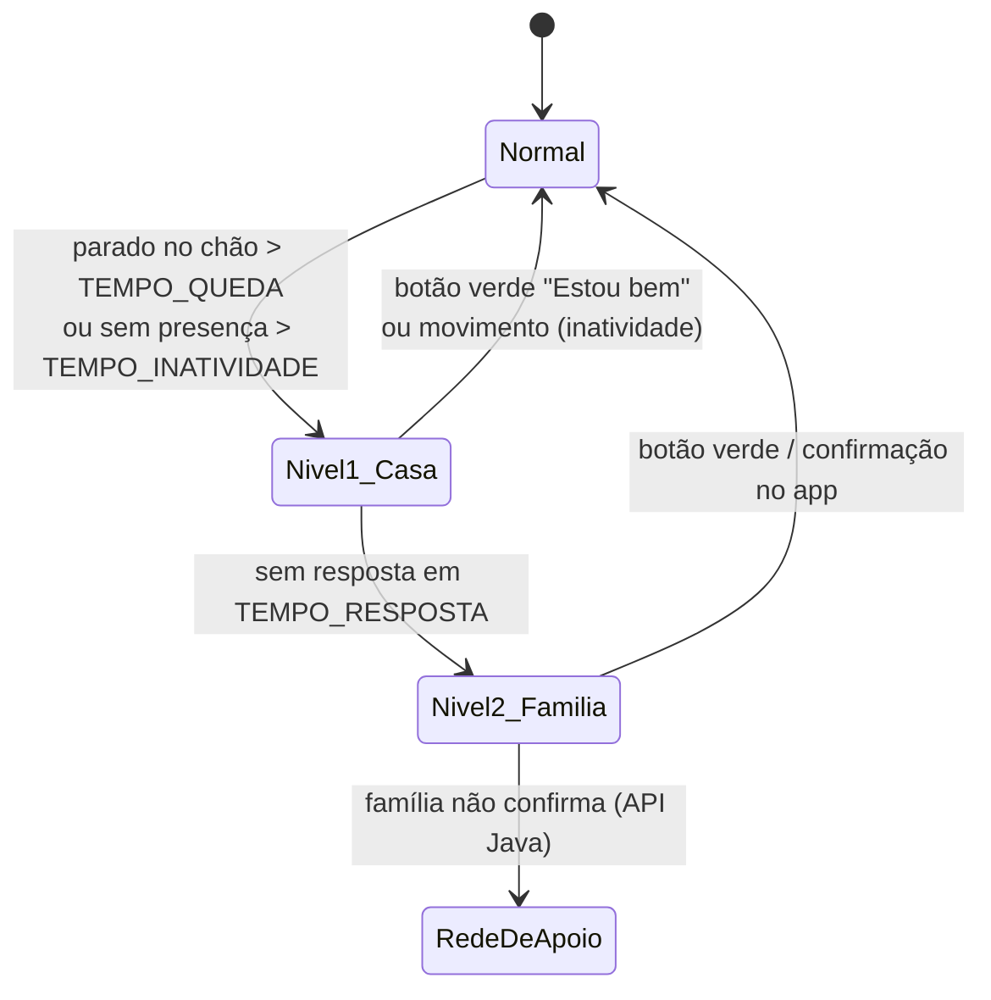
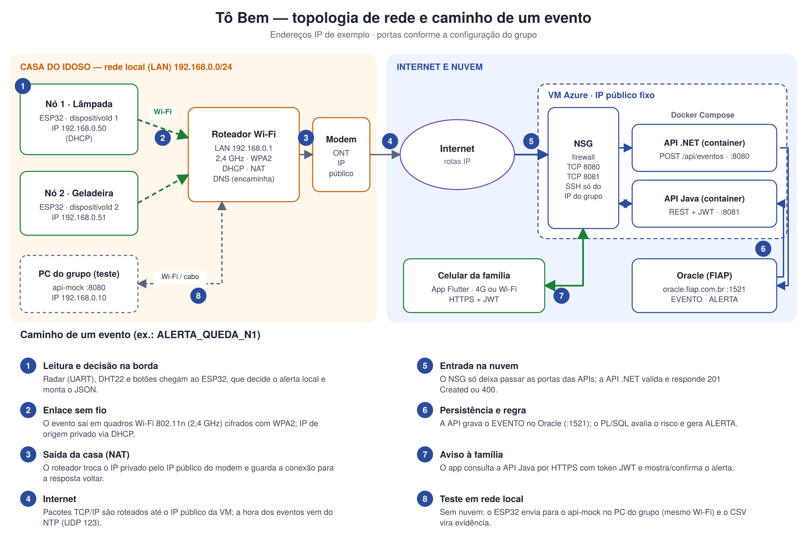
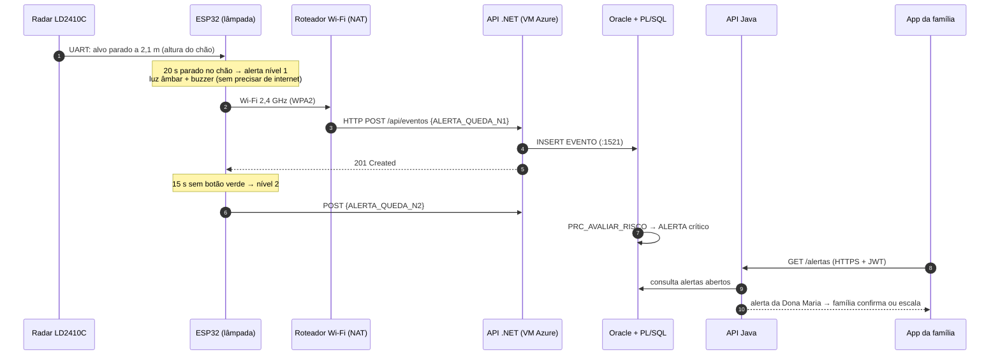

# Tô Bem — a lâmpada que cuida de quem mora sozinho

> **Global Solution 2026/2 · CitizenTech · FIAP — Disruptive Architectures: IoT, IoB & Generative IA**
>
> Uma lâmpada com radar embutido que percebe a rotina de um idoso que mora sozinho, acende uma luz noturna para evitar quedas, detecta quando ele fica imóvel no chão por tempo demais e avisa a família. **Sem câmera e sem depender de o idoso apertar um botão.**

## Integrantes

| Nome completo | RM | Turma |
|---|---|---|
| _Nome do integrante 1_ | RM000000 | 2TDS |
| _Nome do integrante 2_ | RM000000 | 2TDS |
| _Nome do integrante 3_ | RM000000 | 2TDS |
| _Nome do integrante 4_ | RM000000 | 2TDS |
| _Nome do integrante 5_ | RM000000 | 2TDS |

## Onde está cada requisito da avaliação

| # | Requisito (pontos) | Onde encontrar |
|---|---|---|
| 01 | Problema e proposta CitizenTech (10) | [§1 Problema e proposta](#1-problema-e-proposta-citizentech) |
| 02 | Desenvolvimento do protótipo (25) | [§3 Protótipo](#3-protótipo), [`firmware/`](firmware/), [circuito](docs/img/circuito-lampada.png), [`simulacao-wokwi/`](simulacao-wokwi/), [`hardware-3d/`](hardware-3d/) |
| 03 | Componentes e fluxo de comunicação em rede (20) | [§4 Comunicação em rede](#4-comunicação-em-rede) e o documento completo [`docs/rede.md`](docs/rede.md) |
| 04 | Diagrama da arquitetura (15) | [§2 Arquitetura](#2-arquitetura), [topologia de rede](docs/img/fluxo-rede.png), [diagrama de sequência](#caminho-de-um-alerta) |
| 05 | Testes, evidências e demonstração (20) | [§6 Testes](#6-testes-e-evidências), [`docs/testes.md`](docs/testes.md), [`evidencias/`](evidencias/) |
| 06 | Documentação técnica e justificativas (10) | [§5 Como executar](#5-como-executar), [§7 Tecnologias](#7-tecnologias-e-justificativas), [`docs/justificativas.md`](docs/justificativas.md) |

---

## 1. Problema e proposta CitizenTech

**O problema.** O Brasil envelhece rápido. O Censo 2022 contou 32,1 milhões de pessoas com 60 anos ou mais, 15,8% da população. Uma estimativa feita a partir do mesmo Censo chega a cerca de 5,7 milhões de idosos morando sozinhos. Segundo a OMS, citada pelo Ministério da Saúde, cerca de 28% dos idosos sofrem ao menos uma queda por ano. Quem mora sozinho e cai pode ficar horas no chão até alguém perceber.

**O que falha hoje:**
- **Botão de pânico (pulseira):** depende de o idoso apertar. Não funciona se ele desmaiou, caiu longe do botão ou esqueceu de usar.
- **Câmeras:** invadem a privacidade e são rejeitadas, principalmente no banheiro e no quarto.
- **Ligação diária da família:** descobre o problema horas ou dias depois.

**A proposta.** O Tô Bem é uma **lâmpada inteligente** com um radar mmWave (sem câmera). Ela fica no teto, onde ninguém esquece de "usar":

| Função | Como acontece |
|---|---|
| **Sinal de vida** | O radar registra presença e movimento ao longo do dia, sem o idoso fazer nada. |
| **Possível queda** | O LD2410C separa "pessoa em movimento" de "pessoa parada" e mede a distância até ela. Pessoa parada **na altura do chão** por tempo demais gera um alerta. |
| **Luz noturna preventiva** | De madrugada, com a luz apagada, o movimento acende uma luz âmbar fraca por alguns minutos para evitar a queda. |
| **Inatividade** | Ninguém detectado por tempo demais gera alerta. O botão "Saí" suspende esse alerta. |
| **"Já tomou café?"** | Um sensor magnético na porta da geladeira (segundo dispositivo) avisa que a rotina começou. |
| **Calor perigoso** | O DHT22 avisa quando a casa passa do limite de temperatura. |
| **Escalonamento** | Nível 1: luz piscando e buzzer na casa, cancelado pelo botão "Estou bem". Nível 2: família no app. Depois: rede de apoio (agente de saúde). |

**Quem ganha:** o idoso (proteção sem câmera e sem pulseira), a família (sabe que está tudo bem sem ligar várias vezes) e o poder público (monitoramento barato em escala, priorizado por risco).

**IoT e IoB.** A lâmpada é o dispositivo IoT. O sistema não guarda imagens: interpreta **padrões de comportamento** (horário habitual de atividade, levantadas na madrugada, abertura da geladeira). Isso é um caso de *Internet of Behaviors* com preservação de privacidade.

### As três funções da lâmpada são independentes

1. **Sensor (radar):** sempre ligado. Não depende da luz.
2. **Luz principal:** só a pessoa controla, pelo botão "Luz". Nunca acende nem apaga sozinha.
3. **Luz noturna:** automática e discreta. Só acende de madrugada, com a luz principal apagada.

Prioridade dos anéis de LED: **alerta** (amarelo/vermelho piscando) > confirmação de botão > luz principal (branca) > luz noturna (âmbar) > apagado.

---

## 2. Arquitetura



| Camada | O que tem | Neste repositório? |
|---|---|---|
| 1 · Percepção | Radar LD2410C, DHT22, MC-38, botões; atuadores: anéis WS2812B e buzzer | Sim |
| 2 · Borda (edge) | ESP32 da lâmpada (regras locais e alerta nível 1) e ESP32 da geladeira | Sim (`firmware/`) |
| 3 · Rede local | Wi-Fi 2,4 GHz WPA2, roteador (DHCP, NAT, DNS), modem do provedor | Proposta e testes em `docs/rede.md` |
| 4 · Internet | TCP/IP até o IP público da VM; NTP para a hora dos eventos | Proposta em `docs/rede.md` |
| 5 · Nuvem | VM Azure com Docker: API .NET de telemetria (`POST /api/eventos`), API Java, Oracle + PL/SQL | Repositórios das outras disciplinas |
| 6 · Pessoas | App Flutter da família, escalonamento, orientação SAMU 192 | Repositório de Mobile |

**Decisão central:** o alerta nível 1 é decidido **no próprio ESP32**. Se a internet cair, a luz e o buzzer avisam quem está em casa do mesmo jeito. A nuvem fica com o histórico, a rotina e o aviso à família.

---

## 3. Protótipo

### 3.1 Hardware

| Componente | Qtd | Função | Por quê (resumo) |
|---|---|---|---|
| ESP32 DevKit V1 (30 pinos) | 1 por nó | Microcontrolador, programado com o **Arduino core** na Arduino IDE | Wi-Fi integrado, sem módulo extra |
| Radar mmWave HLK-LD2410C | 1 | Presença, movimento, pessoa parada e distância | Vê quem está parado (o PIR não vê), sem câmera |
| Anel de LED WS2812B (16 LEDs) | 2 | Luz principal, luz noturna e alerta visual | Um fio de dados, qualquer cor |
| DHT22 (AM2302) | 1 | Temperatura e umidade | ±0,5 °C, suficiente para o alerta de calor |
| Sensor magnético MC-38 | 1 | Porta da geladeira (nó 2) | Passivo, barato, não precisa de energia |
| Botões e buzzer (base) | 3 + 1 | "Estou bem", "Saí/Voltei", "Luz" e aviso sonoro | Lógica testada no Wokwi; pinos reservados no físico |
| Painel e caixas impressas em 3D | — | Carcaça da lâmpada e da caixa da geladeira | Ver [`hardware-3d/`](hardware-3d/) |
| Fonte 5 V ≥ 2 A (USB 3.0 ou carregador) | 1 | Alimentação | O USB 2.0 causou reinícios (brownout) |

### 3.2 Circuito (montagem real)



| Componente | Pino do componente | Pino do ESP32 |
|---|---|---|
| Anel 1 WS2812B | DIN · 5V · GND | **D33** · VIN · GND |
| Anel 2 WS2812B | DIN · 5V · GND | **D25** · VIN · GND |
| Radar LD2410C | TX · RX · OUT · VCC · GND | **D21** (RX do ESP) · **D19** (TX do ESP) · **D18** · VIN (5 V) · GND |
| DHT22 | DATA · VCC · GND | **D32** · 3V3 · GND |
| Botão verde / azul / branco *(base)* | → GND | D13 / D14 / D4 (INPUT_PULLUP) |
| Buzzer *(base)* | + | D26 |
| MC-38 *(no nó 2, ou D27 se ligado na lâmpada)* | fio 1 · fio 2 | **D27** · GND |

> GPIO 34 e 35 do ESP32 são **só de entrada**. Na primeira montagem os dados dos LEDs estavam nesses pinos e os anéis não acendiam. Eles foram mudados para D33 e D25.

### 3.3 Firmware

| Pasta | O que é |
|---|---|
| [`firmware/To-Bem_IoT/`](firmware/To-Bem_IoT/) | **Firmware principal da lâmpada** (hardware real, radar LD2410C ou LD2420) |
| [`firmware/To-Bem_Geladeira/`](firmware/To-Bem_Geladeira/) | Nó 2: ESP32 + MC-38 na geladeira (mesma API, `dispositivoId = 2`) |
| [`firmware/ToBem_Diagnostico/`](firmware/ToBem_Diagnostico/) | Testa cada peça isolada: LEDs, UART do radar (procura pinos e baud), DHT22 e motivo do último reset |
| [`simulacao-wokwi/`](simulacao-wokwi/) | Sistema completo no simulador, incluindo a base (botões, buzzer, geladeira) e o radar simulado |

O `loop()` da lâmpada roda a cada ~20 ms:

1. **Lê o radar.** A distância é suavizada no tempo (1,5 s) e passa por uma histerese de 15 cm para decidir "chão" ou "sentado/em pé" sem ficar oscilando.
2. **Avalia as regras locais:** pessoa parada no chão depois de ter havido movimento → `ALERTA_QUEDA`; ninguém por tempo demais → `ALERTA_INATIVIDADE`; calor sustentado → `TEMPERATURA_ALTA`.
3. **Escalona:** nível 1 (casa: âmbar piscando + bipe curto) → sem resposta → nível 2 (família: vermelho + bipe longo).
4. **Trata os botões, a luz principal e a luz noturna.**
5. **Envia eventos** em JSON por HTTP. O evento `MOVIMENTO` tem limite de 1 a cada 15 s, e o heartbeat leva o sinal Wi-Fi em dBm.
6. **Imprime uma linha `[STATUS]` por segundo** no Serial, que é a evidência dos testes.



| Parâmetro | Demonstração | Produto |
|---|---|---|
| Parado no chão até alertar (`TEMPO_QUEDA_MS`) | 20 s | 20 min |
| Tempo para apertar "Estou bem" (`TEMPO_RESPOSTA_MS`) | 15 s | 2 min |
| Sem presença até alertar (`TEMPO_INATIVIDADE_MS`) | 60 s | horário habitual + 2 h (rotina aprendida) |
| Luz noturna acesa (`DURACAO_NOTURNA_MS`) | 15 s | 3 min |
| Heartbeat (`HEARTBEAT_MS`) | 10 s | 60 s |

---

## 4. Comunicação em rede

O documento completo, com dispositivos, meios, componentes, pilha de protocolos, endereçamento, contrato da mensagem, volume de dados, segurança e evolução, está em **[`docs/rede.md`](docs/rede.md)**.



| Trecho | Meio | Protocolo |
|---|---|---|
| Radar → ESP32 | Fio (UART) | Serial 256000 bps 8N1, protocolo binário do LD2410C |
| DHT22 → ESP32 | Fio (1 fio de dados) | Protocolo single-bus do DHT |
| ESP32 → anéis de LED | Fio | Sinal WS2812 de 800 kHz |
| ESP32 → roteador | Wi-Fi 802.11 b/g/n, 2,4 GHz | WPA2-PSK; IP privado por DHCP |
| Roteador → internet | Ethernet + fibra/cabo do provedor | IPv4 com NAT |
| ESP32 → API .NET | Internet | **HTTP/1.1 `POST /api/eventos` com JSON**, sobre TCP |
| ESP32 → servidor de hora | Internet | NTP (UDP 123) |
| App → API Java | 4G ou Wi-Fi | HTTPS + JWT |

**Mensagem enviada pelo ESP32:**

```json
{ "dispositivoId": 1, "tipo": "ALERTA_QUEDA_N1", "valor": 1.0, "dataHora": "2026-11-18T07:42:10-03:00" }
```

### Caminho de um alerta



---

## 5. Como executar

### 5.1 Firmware no ESP32 (hardware real)

1. Instale a **Arduino IDE 2.x**. Em *Gerenciador de placas*, instale **esp32 by Espressif Systems** e escolha a placa **ESP32 Dev Module**.
2. Em *Gerenciador de bibliotecas*, instale:
   - **Adafruit NeoPixel** (Adafruit)
   - **DHT sensor library for ESPx** (beegee_tokyo), que fornece o `DHTesp.h`
   - **ld2410** (ncmreynolds), só se `RADAR_MODELO` for `2410`
3. Copie `firmware/To-Bem_IoT/secrets.example.h` para **`secrets.h`** na mesma pasta e preencha o Wi-Fi (2,4 GHz) e a `SECRET_API_URL`. O `secrets.h` está no `.gitignore`. Sem ele, o código compila com os valores de exemplo e funciona só no Serial.
4. Abra `To-Bem_IoT.ino`, ligue o ESP32 numa **porta USB 3.0 ou num carregador 5 V 2 A** e faça o upload.
5. Abra o *Monitor Serial* em **115200**. Deve aparecer a animação azul nos anéis e uma linha `[STATUS]` por segundo.

> **No Windows**, a pasta do projeto não pode ter parênteses nem `&` no caminho (erro "bootloader.bin foi inesperado"). Use algo como `C:\Develop\To-Bem\`.

Ajustes no topo do `.ino`:

| Constante | Para quê |
|---|---|
| `DEBUG_RADAR = true` | Mostra as leituras brutas do radar, usadas na calibração |
| `DEMO_MADRUGADA = true` | Considera sempre madrugada, para demonstrar a luz noturna a qualquer hora |
| `LIMIAR_CHAO_CM` | Distância que conta como "chão". **Calibrar** com `ferramentas/analisar_log.py --calibrar` |
| `BRILHO_MAX` | 25–40 no USB do PC; até 90 com fonte de 3 A |

### 5.2 Testar o fluxo de rede sem a nuvem (servidor de teste)

O servidor de teste aceita o mesmo contrato da API .NET. Precisa só do Python 3.8+, sem instalar nada:

```bash
cd ferramentas/api-mock
python servidor_eventos.py
```

1. A tela mostra a linha pronta para o `secrets.h`, por exemplo `#define SECRET_API_URL "http://192.168.0.10:8080/api/eventos"`. O PC e o ESP32 precisam estar no **mesmo Wi-Fi**.
2. Abra `http://localhost:8080/` para ver o painel com dispositivos online/offline e os eventos chegando.
3. Cada evento é gravado em `evidencias/logs/eventos_recebidos_AAAAMMDD.csv`, com o horário de chegada e o IP de origem.
4. Se o ESP32 mostrar `API respondeu -1`, libere o Python no Firewall do Windows (rede privada).

Para usar a API .NET real, troque a URL por `http://IP-PUBLICO-DA-VM:8080/api/eventos`.

### 5.3 Simulação no Wokwi

Siga [`simulacao-wokwi/README.md`](simulacao-wokwi/README.md). No simulador, o radar é representado por chaves e um potenciômetro, e a base (botões, buzzer, geladeira) está completa.

### 5.4 Métricas e calibração a partir do log

```bash
# copie o texto do Monitor Serial para um .txt em evidencias/logs/
python ferramentas/analisar_log.py evidencias/logs/teste_F1.txt
python ferramentas/analisar_log.py --calibrar evidencias/logs/sentado.txt evidencias/logs/deitado.txt
```

---

## 6. Testes e evidências

O plano completo, com casos de teste, critérios de aceite, resultados e limitações, está em **[`docs/testes.md`](docs/testes.md)**. As fotos, logs e o CSV dos eventos ficam em [`evidencias/`](evidencias/).

| Grupo | O que valida | Onde |
|---|---|---|
| H · Montagem | Cada peça isolada, alimentação, pinos | Protótipo físico + `ToBem_Diagnostico` |
| F · Funcional | Presença, movimento, queda simulada, inatividade, luz noturna, calor | Protótipo físico |
| W · Base | Botões, buzzer, geladeira, escalonamento completo | Wokwi |
| R · Rede | Envio pela rede, latência, perda, dispositivo offline, Wi-Fi caído | Protótipo físico + servidor de teste / API .NET |

**Métricas adotadas:** taxa de detecção em N repetições, falsos alertas, tempo até o alerta, estabilidade da distância (desvio padrão), latência do POST até a resposta (mediana e p95), taxa de entrega (respostas 2xx), sinal Wi-Fi (dBm) e reinícios por falta de energia.

---

## 7. Tecnologias e justificativas

O detalhamento de cada escolha, com as alternativas consideradas, está em **[`docs/justificativas.md`](docs/justificativas.md)**.

| Escolha | Principal motivo |
|---|---|
| ESP32 com Arduino core | Wi-Fi integrado e o mesmo ecossistema Arduino (IDE, bibliotecas, `setup`/`loop`) |
| Radar LD2410C em vez de PIR ou câmera | Detecta a pessoa **parada** e mede a distância sem capturar imagem |
| Decisão do alerta na borda | O alerta na casa funciona sem internet e menos dados saem de casa |
| Wi-Fi da casa em vez de LoRa, Zigbee ou 4G | Já existe na casa e não precisa de gateway; o 4G fica como contingência |
| HTTP + JSON (REST) em vez de MQTT no MVP | É o mesmo contrato da API .NET, simples de testar e passa por qualquer firewall. MQTT é a evolução |
| Heartbeat com sinal Wi-Fi | Diferencia "dispositivo offline" de "pessoa sem movimento" |

---

## 8. Limitações e próximos passos

- **Calibração por ambiente:** o limite do "chão" depende da altura do teto e da posição da lâmpada. Ventilador, cortina e animais podem gerar movimento falso.
- **Cobertura:** uma lâmpada monitora um cômodo; uma casa real precisaria de 2 a 3.
- **Interruptor:** no produto, a lâmpada só funciona com o interruptor ligado. A proposta é travar o interruptor e usar um botão sem fio. Sem heartbeat, o sistema gera aviso técnico, não alarme.
- **Rede:** o MVP usa HTTP sem TLS e não guarda eventos se o Wi-Fi cair. A evolução prevê HTTPS com token por dispositivo, fila na memória flash e reenvio, MQTT e 4G/SMS como contingência.
- **Base física:** botões, buzzer e reed na lâmpada foram validados no Wokwi. No físico, os pinos estão reservados.

---

## 9. Estrutura do repositório

```
├── firmware/
│   ├── To-Bem_IoT/           firmware da lâmpada (+ secrets.example.h)
│   ├── To-Bem_Geladeira/     nó 2: sensor da geladeira
│   └── ToBem_Diagnostico/    teste de cada peça
├── simulacao-wokwi/          sistema completo no simulador
├── ferramentas/
│   ├── api-mock/             servidor de teste (mesmo contrato da API .NET)
│   └── analisar_log.py       métricas e calibração a partir do log Serial
├── docs/
│   ├── rede.md               componentes e fluxo de comunicação em rede
│   ├── testes.md             casos de teste, resultados, métricas e limitações
│   ├── justificativas.md     escolhas técnicas
│   └── img/                  arquitetura, topologia de rede e circuito (PNG + SVG)
├── hardware-3d/              carcaça da lâmpada e caixa da geladeira (OpenSCAD + STL)
├── evidencias/               fotos, logs do Serial e CSV dos eventos recebidos
└── entrega.txt               modelo do .txt de entrega
```

## 10. Integração com as outras disciplinas

| Disciplina | Repositório | Relação com este |
|---|---|---|
| .NET — API de telemetria | _link_ | Recebe o `POST /api/eventos` do ESP32 |
| Java — API principal | _link_ | Alertas, contatos e escalonamento consumidos pelo app |
| Banco de Dados — Oracle + PL/SQL | _link_ | `PRC_REGISTRAR_EVENTO`, `PRC_AVALIAR_RISCO` |
| Mobile — app | _link_ | Painel da família |
| DevOps — VM Azure + Docker | _link_ | Hospeda as APIs |
