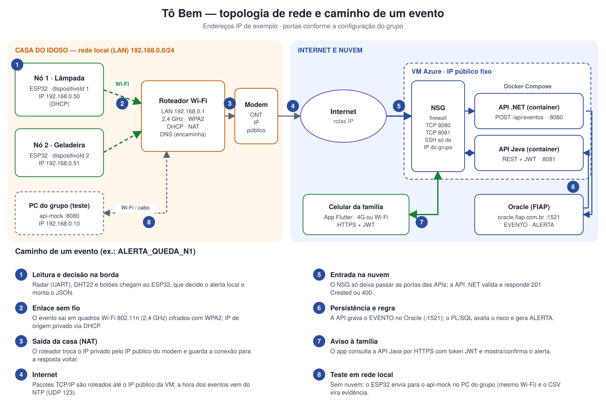
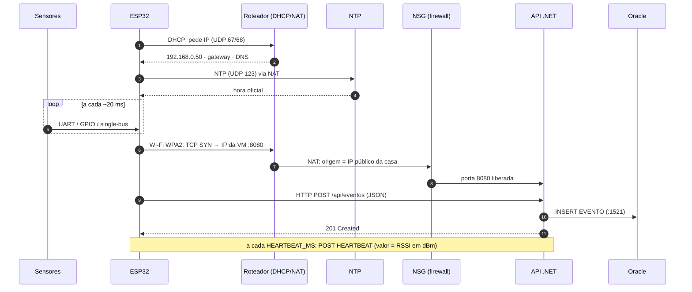

# Comunicação em rede — Tô Bem

Este documento atende ao requisito **03: identificação dos componentes e do fluxo de comunicação em rede**. Ele mostra quais dispositivos participam, por quais meios e protocolos os dados passam, quais equipamentos de rede são necessários e o caminho completo de um evento, do sensor até a família.

---

## 1. Visão em camadas

| Camada | Elementos | Papel na rede |
|---|---|---|
| Percepção | Radar LD2410C, DHT22, MC-38, botões, anéis de LED, buzzer | Geram (ou executam) os sinais físicos, ligados por fio ao microcontrolador |
| Borda (edge) | ESP32 da lâmpada (nó 1) e ESP32 da geladeira (nó 2) | Processam localmente, decidem o alerta na casa e são os **clientes** da rede |
| Rede local | Roteador Wi-Fi da casa, modem/ONT | Acesso sem fio, endereçamento (DHCP), tradução de endereços (NAT) e saída para a internet |
| Internet | Provedor, roteamento IP, DNS, NTP | Transporte até a nuvem; hora certa para os eventos |
| Nuvem | Firewall (NSG), VM Azure, containers Docker das APIs, banco Oracle | Recebem, validam, guardam e avaliam os eventos |
| Aplicação | App da família (celular), escalonamento | Mostra o estado e os alertas para as pessoas |

---

## 2. Dispositivos envolvidos

| Dispositivo | Tipo na rede | Identificação | Como se conecta | O que envia ou recebe |
|---|---|---|---|---|
| **Nó 1 — Lâmpada** (ESP32 + radar + anéis + DHT22) | Cliente IoT (estação Wi-Fi) | `dispositivoId = 1`, MAC do ESP32, IP por DHCP (ex.: 192.168.0.50) | Wi-Fi 2,4 GHz | Envia eventos e heartbeat; recebe a resposta HTTP e a hora (NTP) |
| **Nó 2 — Geladeira** (ESP32 + MC-38) | Cliente IoT (estação Wi-Fi) | `dispositivoId = 2`, IP por DHCP (ex.: 192.168.0.51) | Wi-Fi 2,4 GHz | `GELADEIRA_ABERTA` e heartbeat |
| Base de botões e buzzer | Periférico do nó 1 | — | No protótipo, fios até o nó 1. No produto, botão sem fio (ESP-NOW ou BLE) até a lâmpada | Pressionamentos de botão; acionamento do buzzer |
| Roteador Wi-Fi da casa | Ponto de acesso + roteador | Gateway 192.168.0.1 | Wi-Fi (clientes) e Ethernet (modem) | Encaminha tudo; DHCP, NAT, DNS |
| Modem / ONT do provedor | Acesso à internet | IP público (geralmente dinâmico) | Fibra ou cabo | Leva os pacotes para fora da casa |
| Servidor NTP (`pool.ntp.org`) | Serviço público | Nome DNS | Internet, UDP 123 | Hora oficial para o campo `dataHora` |
| Firewall da nuvem (NSG do Azure) | Filtro de pacotes | Regras por porta e origem | — | Libera só as portas das APIs (e SSH só do IP do grupo) |
| VM Azure (Linux + Docker Compose) | Servidor | **IP público fixo** | Internet | Hospeda os containers das APIs |
| API .NET de telemetria | Serviço HTTP | Porta 8080 (exemplo) | Container | `POST /api/eventos` → 201 / 400 |
| API Java principal | Serviço HTTP | Porta 8081 (exemplo) | Container | Alertas, contatos, JWT; atende o app |
| Banco Oracle (FIAP) | Servidor de banco | `oracle.fiap.com.br:1521` | Internet / Oracle Net | Tabelas `DISPOSITIVO`, `EVENTO`, `ALERTA`; procedures PL/SQL |
| Celular da família | Cliente | — | 4G ou Wi-Fi | App consulta a API Java por HTTPS |
| PC do grupo *(só em teste)* | Servidor de teste | IP na LAN (ex.: 192.168.0.10), porta 8080 | Wi-Fi ou cabo, mesma rede do ESP32 | `ferramentas/api-mock` recebe os eventos e grava o CSV |

---

## 3. Meios de comunicação

| Trecho | Meio físico | Protocolo / formato | Taxa / alcance | Por que este meio |
|---|---|---|---|---|
| Radar → ESP32 | 4 fios curtos (TX, RX, VCC, GND) + 1 digital (OUT) | UART 256000 bps, 8N1; quadros binários do LD2410C (cabeçalho `F4 F3 F2 F1`) | ~10 cm dentro da carcaça | Padrão do módulo. O pino OUT é redundância: se a UART falhar, a presença continua |
| DHT22 → ESP32 | 1 fio de dados | Single-bus proprietário (40 bits por leitura) | Leitura a cada 2,5 s | Simples; o sensor não aceita leituras mais rápidas que 2 s |
| ESP32 → anéis de LED | 1 fio de dados por anel | Sinal WS2812 (800 kHz, 24 bits por LED) | Fio curto | Um único fio controla 16 LEDs coloridos |
| Botões, MC-38 → ESP32 | Fio até o GND | Nível lógico (INPUT_PULLUP) + debounce no código | — | Sem componente extra |
| **ESP32 → roteador** | **Rádio Wi-Fi** | **IEEE 802.11 b/g/n, 2,4 GHz, WPA2-PSK** | ~20–30 m em casa, atravessa paredes | A casa já tem Wi-Fi; nenhum gateway extra. O ESP32 não opera em 5 GHz |
| Roteador → modem | Cabo Ethernet | Ethernet / IPv4 | 100 Mbps+ | Padrão doméstico |
| Casa → nuvem | Fibra ou cabo do provedor | TCP/IP; HTTP/1.1 + JSON | Banda larga | Sem custo extra para a família |
| App → nuvem | 4G ou Wi-Fi do celular | HTTPS (TLS) + JWT | — | A família acompanha de qualquer lugar |
| *Evolução:* botão sem fio → lâmpada | Rádio 2,4 GHz | ESP-NOW (sem roteador) ou BLE | ~10–50 m | Base sem fios, mesmo com o Wi-Fi da casa fora |
| *Evolução:* contingência | Celular | 4G Cat-1 / SMS | — | Avisar mesmo quando a internet da casa cai |

---

## 4. Componentes de rede necessários

| Componente | Função | Configuração necessária |
|---|---|---|
| **Ponto de acesso Wi-Fi 2,4 GHz** (no roteador) | Conectar os ESP32 | Rede 2,4 GHz ativa (ou "banda combinada"), WPA2, SSID e senha no `secrets.h` |
| **Servidor DHCP** (no roteador) | Dar IP, máscara, gateway e DNS aos ESP32 | Recomendado: **reserva de IP por MAC** para a lâmpada, para facilitar o diagnóstico |
| **NAT** (no roteador) | Traduzir o IP privado do ESP32 para o IP público da casa | Padrão. Não precisa abrir porta na casa: o ESP32 sempre **inicia** a conexão (saída) |
| **DNS** | Resolver nomes (`pool.ntp.org`, domínio da API se houver) | Recebido por DHCP |
| **NTP** | Hora correta nos eventos e no horário da "madrugada" | `configTime(-3 * 3600, 0, "pool.ntp.org")` no firmware |
| **Firewall de nuvem (NSG)** | Proteger a VM | Entrada liberada só nas portas das APIs; SSH (22) só do IP do grupo |
| **IP público fixo na VM** | Endereço estável para o firmware | Configurado no Azure; usado na `SECRET_API_URL` |
| **Docker Compose** | Subir as APIs isoladas | Mapeamento de portas do container para a VM (ex.: `8080:8080`) |

---

## 5. Pilha de protocolos de um evento

| Camada TCP/IP (OSI) | No ESP32 → API | Observação |
|---|---|---|
| Aplicação (7) | HTTP/1.1 `POST /api/eventos`, `Content-Type: application/json` | Corpo de ~100 bytes. Também DNS, NTP e DHCP |
| Transporte (4) | TCP, porta de destino 8080 | O HTTP precisa de entrega confiável. NTP, DNS e DHCP usam UDP |
| Internet (3) | IPv4. Origem 192.168.0.50 → NAT → IP público da casa → IP público da VM | Roteamento pelo provedor |
| Enlace / física (2 e 1) | 802.11n 2,4 GHz com WPA2 (casa) → Ethernet → fibra (provedor) | Cada salto troca o enlace; o pacote IP continua o mesmo |

---

## 6. Endereçamento e portas

| Elemento | Endereço (exemplo) | Porta | Protocolo |
|---|---|---|---|
| Rede da casa | 192.168.0.0/24 | — | — |
| Roteador (gateway) | 192.168.0.1 | 53 (DNS), 67 (DHCP) | UDP |
| Lâmpada (nó 1) | 192.168.0.50 (reserva DHCP) | porta de origem efêmera | TCP |
| Geladeira (nó 2) | 192.168.0.51 | porta de origem efêmera | TCP |
| PC com o servidor de teste | 192.168.0.10 | 8080 | TCP/HTTP |
| NTP | `pool.ntp.org` | 123 | UDP |
| VM Azure | IP público fixo | 8080 (API .NET), 8081 (API Java), 22 (SSH restrito) | TCP |
| Oracle FIAP | `oracle.fiap.com.br` | 1521 | TCP (Oracle Net) |

> Os IPs são exemplos de uma rede doméstica comum. O IP real da lâmpada aparece no Monitor Serial ao conectar (`Wi-Fi conectado | IP ... | RSSI ... dBm`). As portas das APIs seguem o `docker-compose` do grupo.

---

## 7. Caminho dos dados, passo a passo

Exemplo: a Dona Maria cai na sala e fica imóvel.

1. **Percepção.** O radar envia pela UART, várias vezes por segundo, quadros com "alvo parado a 2,1 m". O ESP32 suaviza a distância e conclui "altura do chão".
2. **Decisão na borda.** Depois de `TEMPO_QUEDA_MS` parado no chão, tendo havido movimento antes, o ESP32 entra no **nível 1**: anéis em âmbar piscando + buzzer. Isso **não depende de rede**.
3. **Montagem da mensagem.** O ESP32 gera `{"dispositivoId":1,"tipo":"ALERTA_QUEDA_N1","valor":1.0,"dataHora":"..."}` com a hora do NTP.
4. **Wi-Fi.** O quadro 802.11 vai cifrado (WPA2) até o roteador. Origem: IP privado obtido por DHCP.
5. **NAT e internet.** O roteador troca o IP de origem pelo IP público da casa, guarda a tradução e envia pelo modem. Os pacotes são roteados até o IP público da VM.
6. **Nuvem.** O NSG deixa passar a porta 8080. O Docker entrega ao container da API .NET, que valida o JSON e responde **201 Created** (ou **400** se o tipo for inválido). A resposta volta pelo mesmo caminho, graças ao NAT. O ESP32 mede o tempo e imprime `API respondeu 201 em N ms`.
7. **Persistência e regra.** A API grava o `EVENTO` no Oracle. O PL/SQL (`PRC_AVALIAR_RISCO`) cruza com a rotina e gera um `ALERTA`.
8. **Escalonamento.** Sem o botão verde em `TEMPO_RESPOSTA_MS`, o ESP32 envia `ALERTA_QUEDA_N2`. O app da família, que consulta a API Java por HTTPS com JWT, mostra o alerta. Sem confirmação, a API Java escala para a rede de apoio.

---

## 8. Contrato da mensagem

**Requisição:** `POST /api/eventos`, `Content-Type: application/json`

| Campo | Tipo | Obrigatório | Descrição |
|---|---|---|---|
| `dispositivoId` | inteiro > 0 | sim | 1 = lâmpada, 2 = geladeira |
| `tipo` | texto (catálogo abaixo) | sim | O que aconteceu |
| `valor` | número | não (padrão 1) | Depende do tipo (tabela abaixo) |
| `dataHora` | ISO 8601 com fuso (`-03:00`) | não | Hora do dispositivo, via NTP. Sem NTP, o campo é omitido e a API usa a hora de chegada |

**Respostas:** `201 Created` com o evento gravado · `400 Bad Request` com `{"erro": "..."}` (JSON inválido, tipo desconhecido, `dispositivoId` inválido). Para o ESP32, `-1` significa que não houve conexão (timeout de 2 s).

| Tipo | Quem envia | `valor` |
|---|---|---|
| `INICIADO` | lâmpada, geladeira | 1 |
| `HEARTBEAT` | lâmpada, geladeira | **sinal Wi-Fi em dBm** (ex.: -58); 0 = sem Wi-Fi |
| `MOVIMENTO` | lâmpada (no máx. 1 a cada 15 s) | distância em cm |
| `PRESENCA_PARADA` | lâmpada | distância em cm (antes do alerta de queda) |
| `SEM_PRESENCA` | lâmpada | 1 |
| `ALERTA_QUEDA_N1` / `ALERTA_QUEDA_N2` | lâmpada | 1 |
| `ALERTA_INATIVIDADE_N1` / `ALERTA_INATIVIDADE_N2` | lâmpada | 1 |
| `ALERTA_RESOLVIDO_MOVIMENTO` | lâmpada | 1 |
| `BOTAO_OK`, `BOTAO_AUSENTE`, `BOTAO_VOLTEI` | lâmpada (base) | 1 |
| `LUZ_LIGADA`, `LUZ_DESLIGADA` | lâmpada | 1 |
| `TEMPERATURA` | lâmpada (a cada 30 s na demo) | °C |
| `TEMPERATURA_ALTA` | lâmpada | °C |
| `GELADEIRA_ABERTA` | geladeira (ou lâmpada, se o MC-38 estiver no D27) | 1 |

> A API .NET precisa aceitar **todos** esses tipos. Um tipo fora da lista dela volta com 400 e o evento se perde. O servidor de teste (`ferramentas/api-mock`) usa exatamente esta lista e serve de referência para alinhar os repositórios.

---

## 9. Volume de dados (estimativa)

| Item | Premissa | Por dia |
|---|---|---|
| Heartbeat | 1 a cada 60 s (produto) | 1.440 requisições |
| Temperatura | 1 a cada 15 min (produto; na demo é 30 s) | 96 |
| Movimento e outros eventos | ~200 por dia (no máx. 1 a cada 15 s) | ~200 |
| **Total** | ~1.750 requisições × ~1 KB (JSON ~100 B + cabeçalhos HTTP + conexão TCP) | **~1,7 MB/dia ≈ 50 MB/mês por lâmpada** |

É desprezível para a banda larga. Mesmo num plano de dados IoT de 4G, cabe com folga. Migrar para MQTT (conexão persistente, cabeçalho de 2 bytes) reduziria esse volume em mais de 10 vezes. Os números são uma estimativa de projeto, não uma medição.

---

## 10. Segurança e privacidade

| Risco | Medida no MVP | Evolução |
|---|---|---|
| Captura do tráfego Wi-Fi | WPA2 no enlace sem fio | WPA3 onde o roteador suportar |
| Leitura do JSON na internet | — (HTTP) | **HTTPS (TLS)** com o certificado da API no ESP32 (`WiFiClientSecure`) |
| Dispositivo falso enviando eventos | Validação de `dispositivoId` e de `tipo` na API (400) | Token por dispositivo no cabeçalho (`X-Device-Key`) |
| Senha do Wi-Fi no GitHub | `secrets.h` fora do repositório (`.gitignore`); só o `secrets.example.h` é versionado | Provisionamento por Wi-Fi Manager (o idoso não digita nada) |
| VM exposta | NSG libera só as portas das APIs; SSH restrito | Proxy reverso com TLS na porta 443 |
| Privacidade (LGPD) | **Sem câmera nem áudio**: só eventos ("movimento", "porta aberta") saem de casa | Consentimento no app; retenção limitada dos eventos |

---

## 11. Confiabilidade

- **Alerta local independe da rede:** a queda é detectada e sinalizada na casa (luz + buzzer) mesmo sem Wi-Fi ou internet.
- **Heartbeat:** sem notícia por 3 intervalos, o servidor marca o dispositivo como **OFFLINE**. Isso é um **aviso técnico, não uma emergência**: queda de Wi-Fi não é confundida com queda da pessoa.
- **Timeout de 2 s no HTTP:** se a API estiver fora, o `loop()` não trava e as regras locais continuam rodando.
- **Reconexão automática:** o ESP32 tenta voltar ao Wi-Fi sozinho. O sinal (RSSI) vai em cada heartbeat para diagnosticar lâmpadas longe do roteador.
- **Sem NTP:** o evento vai sem `dataHora` e a API usa a hora de chegada.
- **Energia:** a potência do rádio Wi-Fi foi limitada a 11 dBm e o brilho dos LEDs a ~15%. Isso evita os reinícios por queda de tensão (brownout) observados no USB 2.0.

---

## 12. Evolução proposta da rede

| Hoje (MVP) | Evolução | Ganho |
|---|---|---|
| HTTP POST por evento | **MQTT** (broker em container, QoS 1, tópico `tobem/{idoso}/{dispositivo}/evento`) | Conexão persistente, menos bytes, mensagens retidas e *last will* para offline |
| HTTP | HTTPS / MQTTS | Confidencialidade e autenticidade |
| Eventos perdidos sem Wi-Fi | Fila na memória flash + reenvio | Nenhum evento perdido |
| Botões com fio | ESP-NOW ou BLE até a lâmpada | Base sem fios |
| Só Wi-Fi da casa | Módulo 4G Cat-1 com SMS de contingência | Alerta mesmo com a internet da casa fora |
| Uma lâmpada | Malha de lâmpadas (uma por cômodo) | Cobertura da casa inteira |
