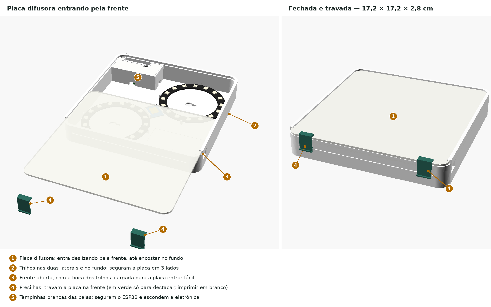
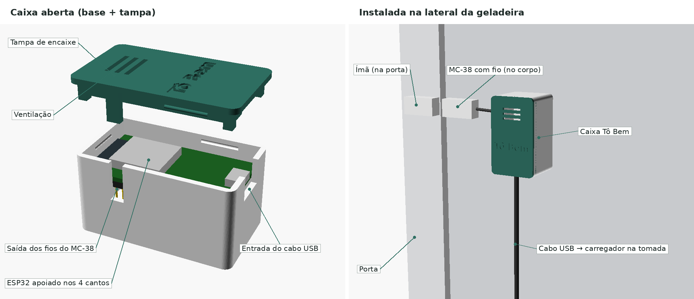

# Peças impressas em 3D

Modelos paramétricos em **OpenSCAD** (gratuito). Abra o `.scad`, ajuste as medidas no topo, aperte F6 e exporte em STL. Os `.stl` daqui já estão prontos para o fatiador da impressora.

| Pasta | Peça | Arquivos para imprimir |
|---|---|---|
| `lampada/` | Carcaça da lâmpada (17,2 × 17,2 × 2,8 cm): radar no centro entre os dois anéis, ESP32 e DHT22 em baias separadas, furos para parafusar no teto e entrada deslizante para a placa difusora (≤ 2 mm) | `tobem_lampada_v4_base.stl`, `tobem_lampada_v4_presilha.stl` (2 a 4×), `tobem_lampada_v4_tampa_esp.stl`, `tobem_lampada_v4_tampa_alim.stl` · gabarito de corte da placa: `gabarito_placa_difusora.pdf` |
| `caixa-geladeira/` | Caixa do nó da geladeira (ESP32 + fios do MC-38), presa na lateral da geladeira | `tobem_caixa_base.stl`, `tobem_caixa_tampa.stl` |

Na frente do radar só pode haver **plástico**: metal bloqueia o sinal de 24 GHz.

